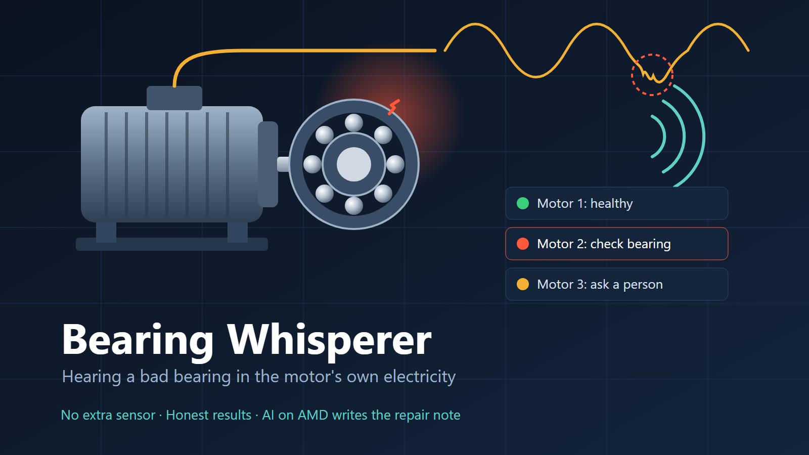
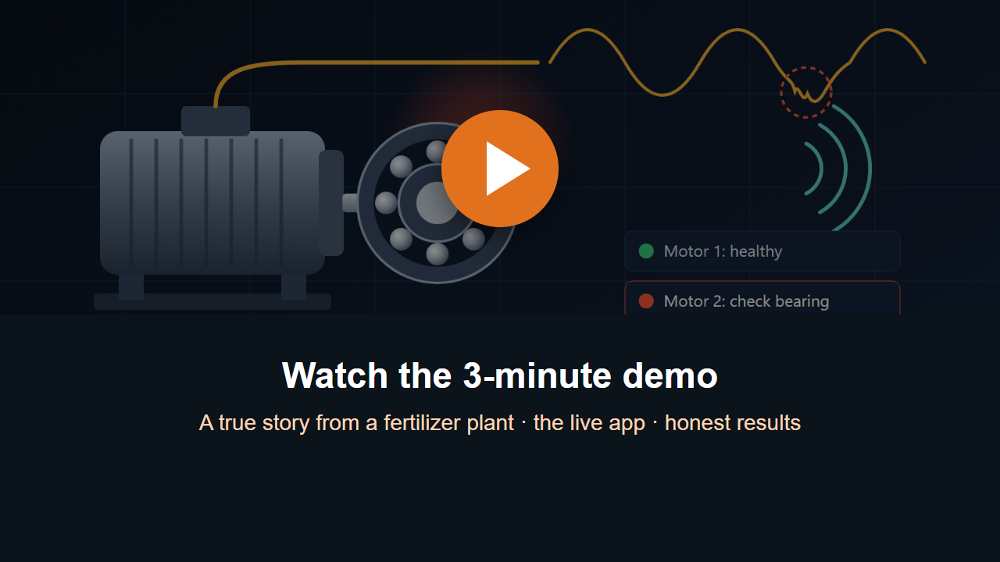
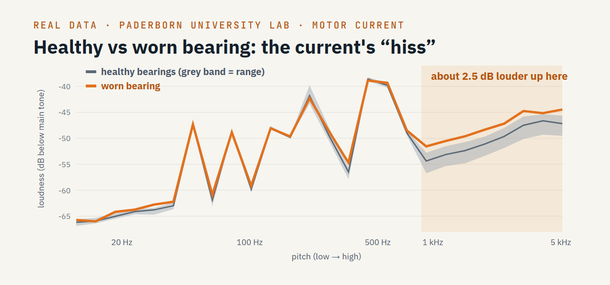
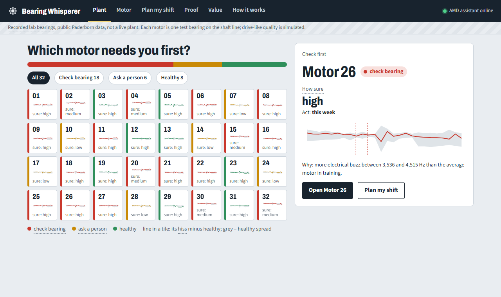
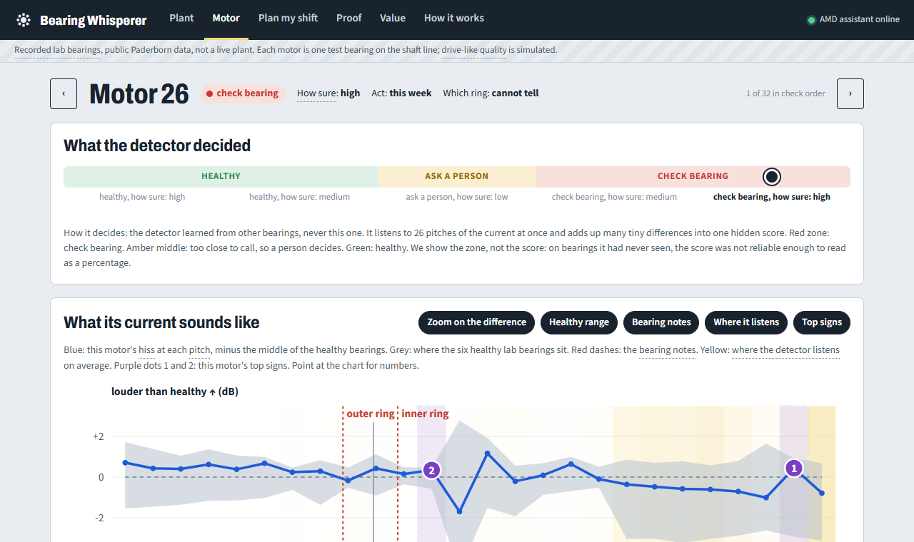
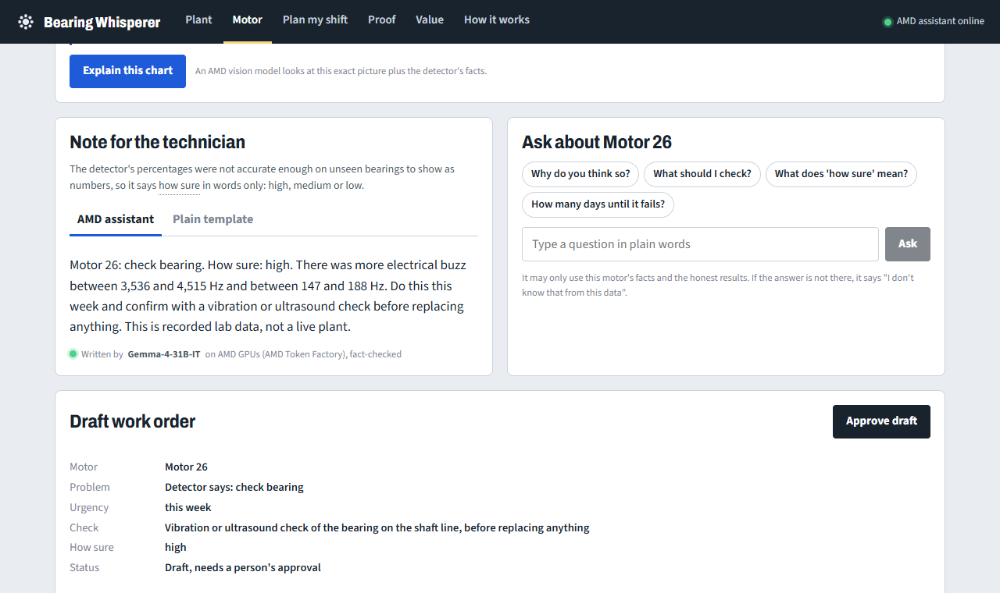
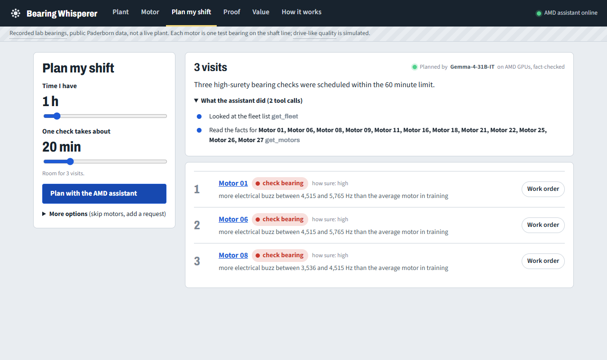
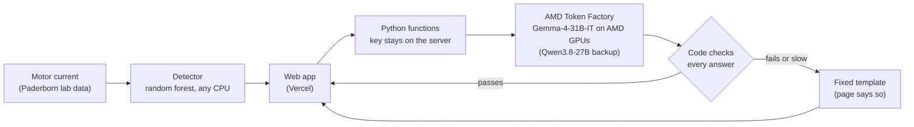
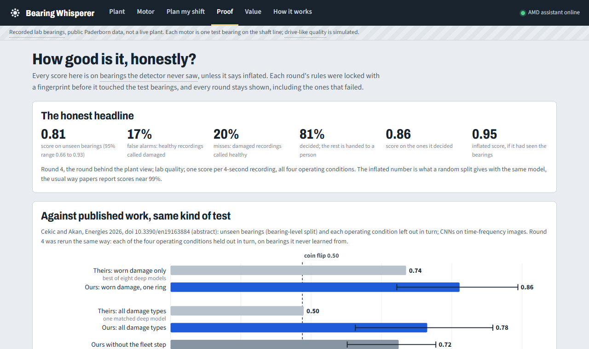
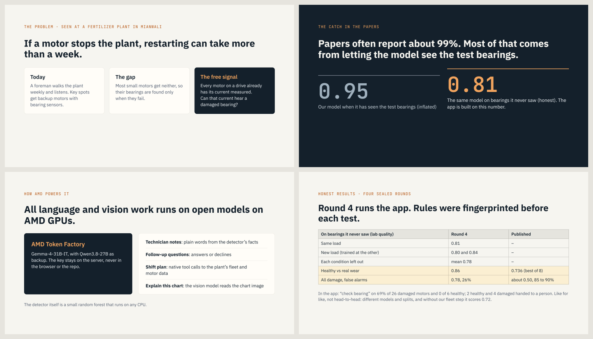

<div align="center">



# Bearing Whisperer

**Hear a failing bearing in the motor current a drive already measures.**
Tested honestly on bearings it never saw. Explained by Gemma on AMD.

[**▶ Open the live app**](https://bearing-whisperer.vercel.app/) · [**Watch the demo**](docs/demo.mp4) · [**Slides (PDF)**](docs/slides.pdf)

AMD Developer Hackathon ACT III · Track 1 "Intelligent Industry" · AMD Token Factory · Gemma-4-31B-IT · Qwen3.8-27B

</div>

---

## Watch the 3-minute demo

<a href="docs/demo.mp4"></a>

## The problem: I saw it at a fertilizer plant

I worked at Pak-American Fertilizers, a urea and ammonia plant in Daudkhel, Mianwali (Pakistan). Every week a foreman walked the plant and listened to the
motors. If a motor stops the plant, restarting can take **more than a week**. Only key spots had backup motors with
bearing sensors. **Most motors had no sensor at all.**

But every motor on a drive already has its **current measured, for free**. Can that current hear a damaged bearing?



*Real data (Paderborn University lab, 16 kHz drive-like quality): a worn bearing (KA04) against the six healthy ones.
Its current is about 2.5 dB louder above 1 kHz. Small, but a model can learn it.*

## What the app does

| | |
| :---: | :---: |
| <br>**Plant:** 32 motors on one screen: check bearing, ask a person, or healthy. The motor to check first is highlighted. | <br>**Motor:** the verdict in words (never a fake percentage) and the motor's "hiss picture" with its top two signs. |
| <br>**Technician note:** written by Gemma on AMD, every number fact-checked in code; a draft work order a person approves. | <br>**Plan my shift:** the AMD assistant calls the plant's tools (fleet list, motor facts) and returns an ordered visit list. |

Also: **Explain this chart** (a vision model on AMD reads the exact chart), **Proof** (every test round, failures
included), **Value** (an illustrative yearly value with sliders).

## How AMD powers it, and why the AI can't make things up



- **Gemma on AMD Token Factory** writes the technician notes, answers follow-up questions, plans the shift with
  **native tool calls**, and reads charts from **images**.
- **Every answer is checked in code before it is shown:** only numbers from the detector's facts, never against the
  verdict, never "days until failure"; a plan may only name motors the tools returned.
- **Fixed test:** 10 questions written in advance, on 3 motors: **30 of 30** answers passed the check, and **9 of 9**
  trick questions (days to failure, which ring, the brand) were declined.

## Honest results

Papers on this data often report about 99%, but most let the model see the test bearings. Our model scores **0.95**
that way and **0.81** on bearings it has never seen. The app is built on the honest number.



Balanced accuracy on **unseen bearings** (0.50 = coin flip). Every round's rules were fingerprinted (SHA-256) before
testing, and every round stays reported, failures included.

| Round 4 (runs the app) | Lab quality | Drive-like (16 kHz, simulated) |
| --- | --- | --- |
| Same load | **0.81** (0.66 to 0.93) | 0.82 |
| New load (trained at the other) | 0.80 and 0.84 | 0.77 and 0.78 |
| Each condition left out (the published test) | mean **0.78** | mean 0.81 |
| Inflated (bearings seen, for comparison) | 0.95 | |

**Against published work, like for like** (Cekic and Akan, *Energies* 2026): healthy vs real wear **0.86** vs their
best **0.736**; all damage **0.78 with 26% false alarms** vs about **0.50 with 85 to 90%**. Not head-to-head (different
models and splits); without our "compare with the fleet" step we score 0.72.

**In the app:** "check bearing" on 69% of 26 damaged motors and on **none** of the 6 healthy ones; 2 healthy and 4
damaged motors are handed to a person.

<details>
<summary><b>What it cannot do yet</b> (we say this as loudly as the good news)</summary>

- It hears broad hiss above 1 kHz, not the bearing's classic notes (0.45 on those alone).
- Bigger damage is not flagged more (90%, 72%, 44% by size level).
- Only six healthy bearings exist; a null test matched the real score once in 10 tries. Results are exploratory.
- The healthy bearing with the shortest run-in (K003, 1 hour) is flagged most, so the app hands it to a person.
- It cannot tell which ring is damaged (0.61, reaches chance), so the app says "cannot tell".
- On the dataset authors' own split it scores 36% (three answers, about guessing).
- The tested bearing sits on the shaft line, outside the motor; drive-like sensor quality is simulated.
- Never claimed: days until failure, any drive brand's sensor.

Four sealed rounds: `prereg/` (rules and fingerprints), `results/` (every number).
</details>

## Slides

<a href="docs/slides.pdf"></a>

## Run it

```bash
py -3.12 -m venv .venv
.venv/Scripts/python -m pip install -r requirements.txt
cp .env.example .env                              # put your AMD Token Factory key in .env
.venv/Scripts/python -m pytest -q                 # 144 tests
.venv/Scripts/python web/dev_api.py               # local server functions on :8787
cd web && npm install && npx vite                 # app on :5173
```

Deploy: `web/` is a Vercel project (Vite plus Python functions in `web/api/`); set `AMD_KEY` in its environment
variables. Without a key the app still works with template notes and a rule-based plan. To remake the results:
features on Kaggle (`kaggle/`), then `python -m bearing.round4` (earlier rounds: `bearing.evaluate`, `round2`,
`round3`).

## Data and licence

Paderborn University bearing data: Lessmeier, Kimotho, Zimmer, Sextro, PHME 2016, **CC BY-NC 4.0**. The raw data is
not in this repository; `results/` and `web/public/data/` are derived from it under the same licence. Our code: MIT.
